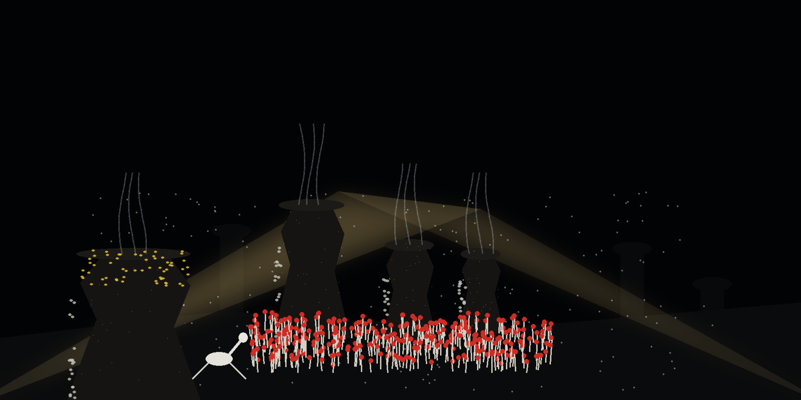

# GMT-World-Time-Calculator

Rule-based AI Time Prediction: a small interactive Python program that
prints the current time in a city you name, computed from UTC with a
fixed per-city offset. There is no machine learning model; the "AI" is
the fixed rule table in `ai_time.py`.


## Run

```bash
python3 ai_time.py
```

Python 3, standard library only. At the `Enter city:` prompt, type one
of the supported cities, or `exit` to quit. Closing the input (EOF)
also ends the program cleanly.


## Supported cities and offsets

| City | Offset from UTC |
| --- | --- |
| Boston | -4 hours |
| Chicago | -5 hours |
| Seattle | -7 hours |
| Cairo | +2 hours |
| Karachi | +5 hours |
| Kolkata | +5 hours 30 minutes |
| Shanghai | +8 hours |
| Tokyo | +9 hours |

City names are matched without regard to case or surrounding spaces,
so `tokyo` and ` Tokyo ` both work, and `exit` quits the same way. Any
other city prints `<city> is not added` and then shows the UTC time
labeled GMT.


## Honest limits

- Offsets are fixed constants in the code. They do not adjust for
  daylight saving changes, so a listed offset can differ from a city's
  civil time during the part of the year when that city is on the other
  side of a daylight saving switch.
- The printed time is the current time of day only (hour, minute,
  second, zero-padded). No date is shown, even when an offset
  crosses midnight.
- Times wrap correctly across midnight in both directions, and the
  Kolkata half hour carries into the hour when the minutes pass 59.


## Files

- `ai_time.py`: the whole program. The offset math sits in
  `time_for_city(city, now_utc)`, separate from the prompt loop, so it
  can be tested with a fixed time.
- `test_ai_time.py`: unit and scripted-run tests
  (`python3 -m unittest`).
- `logo.png`, `banner.png`: generated branding.
- `LICENSE`: GNU General Public License v3.


> Dive log margin note: fixed offsets do not adjust for daylight saving, so a listed offset can differ from civil time at a saving switch.
> Dive log margin note: no date is shown, even when an offset crosses midnight.
> Dive log margin note: an unknown city prints <city> is not added, then shows the UTC time labelled GMT.
